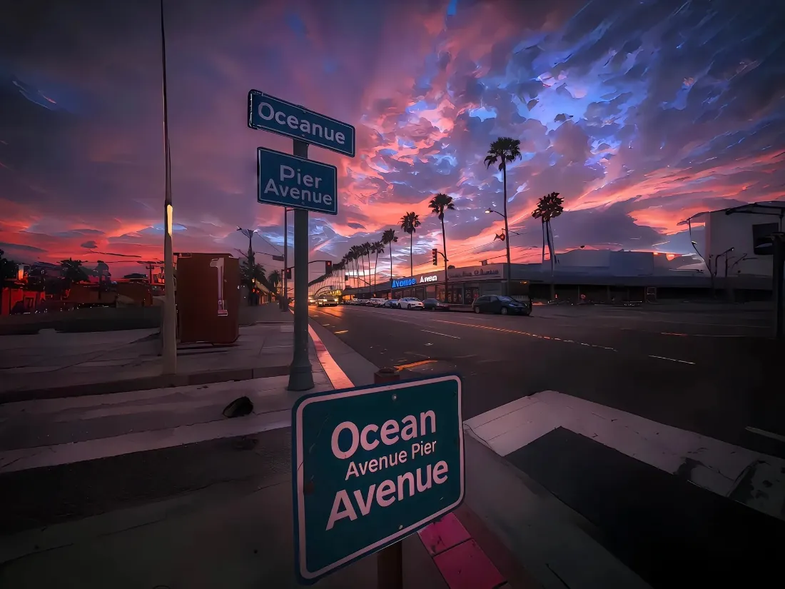

---

盛夏刚过，又是一年秋。今年的秋天来的格外的慢，像是一盘年老的石磨，要反复研磨才能完成目标，可那份凉意却已经先到了，想要裹挟着人的疼痛吹到昨日。 
人们都说秋天是丰收的季节，但在诗词里秋天大多是悲伤的基调，现实更是如此。丰收没等到，等来的却是止不住的烦恼。学业的压力，家人的身体问题像龙卷风般席卷而来。人最可怕的不是承受不住，而是没有能力去帮，焦虑在心底里不断的蔓延。唐吉诃德式的冲锋，面对现实还是太苍白了。
从前觉得自己年龄太大了，可现在只恨自己没有更年长一点。奥德赛时期也教不了我怎么解决问题，可人生确实都是死胡同。 一个秋天怎么可能读得懂，留给我的试卷上面只有个解字，之后呢，耶稣都难续写。苦楚比夜间的秋水更难消失，秋水扎根秋天，苦楚植根心底。我到底要度过多少个秋天才能迎来丰收？天空不会告诉我，时间也只是照样轮转。嘴里的那口糖要化了，我的夏天比秋天先结束了。但我想我总会看到冬天的，毕竟，我依旧年少。