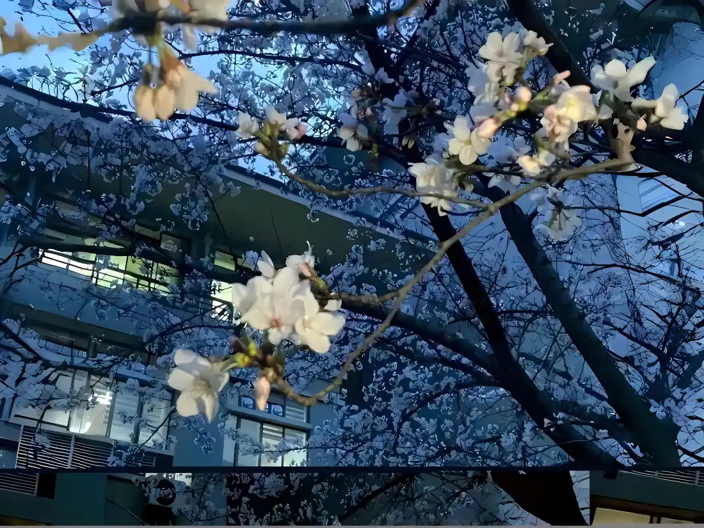

---

得不到幸福的人大多都是孤寂的，他们习惯于把心事塞到冰块里，然后一口饮下。这样说话的时候能够更含糊不清，所以当幸福来临的那一刻，他们就能顺利地糊弄过去。 有的人很不理解，那你为什么不选择接住呢？明明幸福就在你的眼前，只要触摸，只要伸手，没准就真的可以。 
可只要仔细地去想，你就会发现，我们根本接不住的，那份后果你与我都是承担不了的。 人们总是期待着与喜欢的人产生情结，可这是个死结还是个活结，他们不想去探究一点。仿佛遗忘就能让他们短暂地承受这份快乐。 之后呢？明天呢？那份快乐的底下藏着巨大的空虚和不真实，最终只能像野狗一样在离别的时候哀嚎。 有的人不长记性，有的人想要幸福。于是这份循环，在一段又一段关系中持续扮演着跑龙套的角色。 而时间久了，这份想法也逐渐变成了执念。执念落在土里，这么多年还是无缘发芽。 
想来也是，人生的柳暗花明，哪那么容易到达手中。最后那些仓促的结尾，还是要用一生来平淡。 所以这么多年，我很羡慕那种大结局一样的开场白，仿佛只要看一眼就能体会到相同的幸福。 至于能不能得到，我想每个人都会的。命运刺痛我们太多年了，而那份赔偿总会在某一刻真的降临。