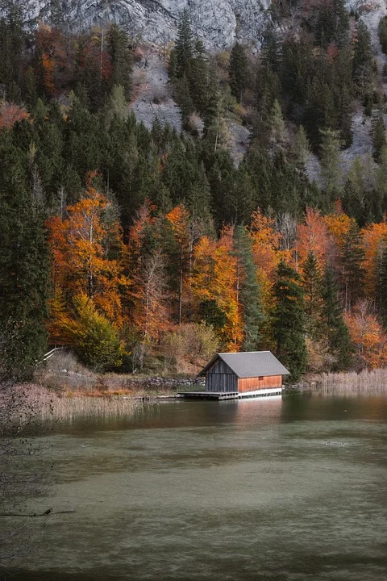

---

人离开一个地方的时候，往往只带走了行李，带不走自己。 很多年以后才会发现，人这一生好像不是一直在往前走，而是一并往前走，一边把不同年纪的自己落在不同的地方。 有人把十七岁落到教室最后一排，课本立的很高心思却总往窗外跑。晚自习的风一吹，就觉得以后一定会去很远的地方。有人把第一次离家落在车站，心里想不大野心倒是不小。明明什么都还没有，却以经为以后的自己想好了样子。有人把最穷的几年落在一间出租屋，一张窗，一张桌子。窗外是凌晨还亮着灯的楼，卡里的余额算了很多遍，手机里也有一直没收到的消息。可奇怪的是，那时候的人反而比后来更相信明天一定会发生一点什么。还有的人把喜欢落在了一条街上，后来那条街修过路，换过店面，连路边那条小店都不在了，可是只要重新走过一次，还是会想起当年那个自己。把一句话在心里练了很多遍，最后也没有说出口。所以后来人们怀念一个地方，通常不是那里真的有多好。而是有一段时间你真的把自己活在了那里里。

后来去了更大的城市，认识了更多的人，学会了体面的介绍自己，你也学会了把喜欢说成还好，把希望说成来算了，把真正想去的地方说成以后再看吧。人还是在往前走，只是走到某个年纪以后，会突然发现，有些地方之所以难忘，不是因为回不去，而是真的回去了也只能把那条路重新走一遍，却找不会当年留在那里的个人。 教室还在座位已经换了别人，车站还在，可站台上已经没有了那个第一次独自出发的人。出租屋也许还在，窗外的灯还是一样亮，可那个一遍算着余额，一遍坚信自己迟早会好起来的人，已经不住在那里了。

人就是这样，一边生活，一边把自己落在世界各处。落在一场没等到的雨里，落在一条每天都嫌远的路上，落在一间再也没回去的房间里，也落在某个人还没有离开的那几年里。 所以有时候，并不是你突然想回到那里，只是走着走着有一个旧地方，突然把你认出来了。他提醒你，原来许多年前，你也曾经那样活过。没什么钱，没什么把握。甚至没有什么像样的答案。可喜欢就是喜欢。想去远方，也真的敢认真想一想。总觉得日子虽然普通，以后一定会慢慢亮起来。后来见过很多更大的世界，才明白真正舍不得的，往往不是某一座城，某一条街，某一个房间。而是那些地方，替你保存过一个后来再也没有出现过的自己。